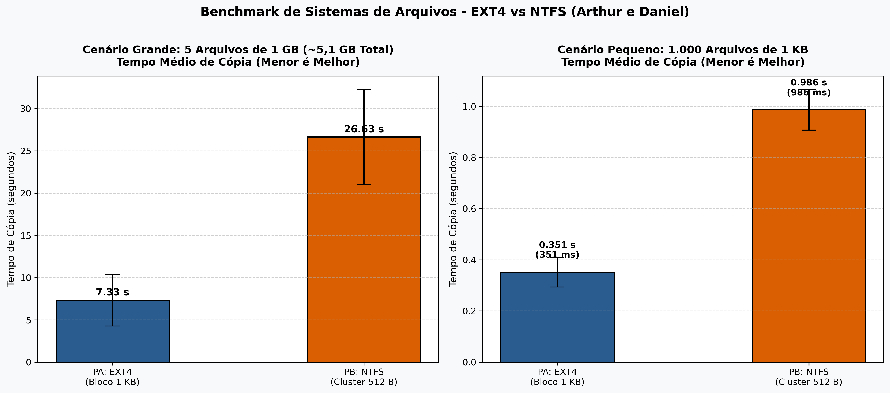

# Benchmark de Sistemas de Arquivos: EXT4 vs. NTFS

> **Trabalho Prático da Disciplina de Sistemas Operacionais**  
> **Professor:** Sérgio  
> **Autores:** Arthur e Daniel  
> **Repositório:** [trabalho-so-arthur-daniel](https://github.com/KaynannX/trabalho-so-arthur-daniel)  
> **Ambiente:** Linux (Kernel 6.18 via WSL2 / Ubuntu 24.04 LTS) sobre Host Windows 11  

---

## 📌 1. Visão Geral do Projeto

Este projeto consiste na implementação, execução e análise crítica de um **benchmark empírico de cópia de arquivos**, comparando o desempenho de dois sistemas de arquivos amplamente utilizados (**EXT4** e **NTFS**) configurados com unidades mínimas de alocação de blocos/clusters.

### Configuração Avaliada (Opção 3 do Enunciado)
* **Partição A (PA):** Formatada em **EXT4** com tamanho de bloco mínimo de **1.024 bytes (1 KB)**.
* **Partição B (PB):** Formatada em **NTFS** com tamanho de cluster mínimo de **512 bytes**.

O objetivo central é investigar o comportamento dos sistemas operacionais frente a duas cargas de trabalho antagônicas:
1. **Sobrecarga de Metadados (*Metadata Bound*):** Escrita concorrente e serial de **1.000 arquivos pequenos (1 KB cada)**.
2. **Taxa de Transferência Contínua (*Throughput Bound*):** Escrita sequencial massiva de **5 arquivos grandes (1 GB cada)**, totalizando 5 GB gravados por repetição.

---

## 🏗️ 2. Estrutura do Repositório

```plaintext
trabalho-so-arthur-daniel/
├── README.md                  # Este documento: documentação executiva e instruções
├── relatorio_benchmark.md     # Relatório técnico completo com fundamentação e dados
├── grafico_benchmark.png      # Gráficos comparativos gerados via Matplotlib (lote e unitário)
├── benchmark.py               # Orquestrador autônomo em Python 3 (medições, logs, gráficos e relatório)
├── benchmark.sh               # Script de execução em Bash (alternativa nativa em shell)
├── setup_disk.sh              # Script de provisionamento do disco virtual via losetup e particionamento GPT
└── logs/
    ├── benchmark_resultados.csv   # Dados brutos das 10 repetições de cada cenário (40 amostras)
    └── benchmark_execucao.log     # Log detalhado da execução com timestamps
```

---

## ⚙️ 3. Metodologia Experimental e Rigor Científico

Para garantir a validade das medições e a segurança da estação de trabalho:

### 3.1. Isolamento Físico via Dispositivo de Bloco (`losetup`)
Em vez de manipular arriscadamente partições físicas (`/dev/sdb`), foi provisionado um disco virtual de 25 GB (`/var/tmp/benchmark_disk.img`) associado via **Loop Device particionado (`losetup -P`)**:
* Nós criados pelo kernel: `/dev/loop0p1` (PA) e `/dev/loop0p2` (PB).
* **Defesa Técnica:** No Linux, loop devices operam como dispositivos de bloco reais no subsistema de I/O (filas de I/O, I/O schedulers, suporte a ioctl e montagem direta pelo VFS), garantindo fidelidade de hardware sem riscos de corrupção ao SSD físico do hospedeiro.

### 3.2. Nomenclatura Estrita dos Conjuntos de Dados
Os dados de origem foram mantidos no sistema de arquivos local nativo (evitando gargalos de protocolos de tradução como 9P) nos diretórios:
* `grande/`: Contém os arquivos sequenciais de **1 GB** cada.
* `pequena/`: Contém os **1.000 arquivos de 1 KB** cada.

### 3.3. Neutralização Obrigatória do Cache de RAM (`drop_caches`)
A cada repetição dos testes:
1. É disparado o esvaziamento forçado de buffers pendentes (`sync`).
2. É purgada toda a memória de `PageCache`, `dentries` e `inodes` através de:
   ```bash
   echo 3 > /proc/sys/vm/drop_caches
   ```
3. A medição é temporizada com precisão de microssegundos (`time.perf_counter()`), exigindo novo `sync` antes de parar o cronômetro para garantir que todos os dados foram persistidos no disco.
4. O diretório de destino é limpo entre repetições para evitar esgotamento de espaço.

---

## 📊 4. Resultados Obtidos

Foram realizadas **10 repetições completas** para cada um dos 4 cenários (totalizando 40 testes empíricos). A tabela a seguir apresenta os resultados médios sob as duas perspectivas: **tempo por lote completo** e **tempo unitário por arquivo copiado**:

| Cenário de Teste | PA: EXT4 (Bloco 1 KB) | PB: NTFS (Cluster 512 B) | Diferença / Razão | Sistema Mais Rápido |
| :--- | :---: | :---: | :---: | :---: |
| **Grandes — Lote Total (5 x 1 GB)** | **7.329 s** (±3.04s) | **26.632 s** (±5.60s) | EXT4 ~3.6x mais rápido (+263.4%) | **EXT4** |
| **Grandes — Por Arquivo (1 GB unitário)** | **~1.466 s** | **~5.326 s** | EXT4 ~3.6x mais rápido | **EXT4** |
| **Pequenos — Lote Total (1000 x 1 KB)** | **0.351 s** (±0.06s) | **0.986 s** (±0.08s) | EXT4 ~2.8x mais rápido (+180.8%) | **EXT4** |
| **Pequenos — Por Arquivo (1 KB unitário)** | **~0.351 ms** (351 µs) | **~0.986 ms** (986 µs) | EXT4 ~2.8x mais rápido | **EXT4** |

### Gráfico Comparativo de Desempenho



---

## 🔬 5. Discussão Teórica e Defesa dos Números

O **EXT4 superou o NTFS em todos os cenários** (~3.6x mais rápido em arquivos grandes e ~2.8x em pequenos). Os motivos fundamentam-se na arquitetura interna dos sistemas operacionais:

1. **Volume de Entradas de Alocação (Cluster 512B vs. Bloco 1KB):**  
   Ao alocar 5 GB de dados com cluster mínimo de 512 bytes no NTFS, o sistema precisou gerenciar **10.485.760 clusters**, enquanto o EXT4 (bloco de 1.024 bytes) gerenciou **5.242.880 blocos** (exatamente a metade). Isso impôs ao NTFS o dobro de pesquisas, alterações de bits no mapa `$Bitmap` e maior sobrecarga no log de transações.
2. **Extents vs. Master File Table (MFT):**  
   O EXT4 agrupa blocos contíguos em **Extents** (um único descritor de 12 bytes endereça até 128 MB contíguos), demandando pouquíssimos metadados para arquivos grandes. No NTFS, ponteiros de alocação de arquivos residem nos registros da MFT; com clusters diminutos, a tabela sofre intensa fragmentação e latência de diário (`$LogFile`).
3. **Driver no Kernel Linux (VFS Nativo em Ring 0 vs. Tradução/FUSE):**  
   O EXT4 é compilado nativamente no Kernel Linux, beneficiando-se de *delayed allocation*, pré-alocação contígua e zero troca de contexto. O NTFS depende de camadas de tradução (`ntfs-3g` operando via FUSE em espaço de usuário). Para as 1.000 cópias de arquivos pequenos, as milhares de chamadas de sistema (`creat`, `write`, `close`, `sync`) provocaram constantes trocas de contexto (*context switching*) entre Kernel Space e User Space, degradando a performance do NTFS.
4. **Fragmentação Interna Nula (0%):**  
   Para arquivos de 1 KB: no EXT4 (bloco 1 KB) ocupam 1 bloco exato; no NTFS (cluster 512 B) ocupam 2 clusters exatos. A perda por fragmentação interna foi **0%** em ambos, confirmando que a diferença de velocidade decorre puramente da sobrecarga estrutural de metadados e drivers.

---

## 🚀 6. Como Reproduzir os Experimentos

### Pré-requisitos
* Sistema Linux (Ubuntu 22.04/24.04 ou WSL2 no Windows).
* Pacotes necessários: `python3`, `python3-matplotlib`, `ntfs-3g`, `parted`, `util-linux`, `e2fsprogs`.

### Passo a Passo

1. **Clonar o repositório:**
   ```bash
   git clone https://github.com/KaynannX/trabalho-so-arthur-daniel.git
   cd trabalho-so-arthur-daniel
   ```

2. **Criar e particionar o disco virtual (executar como root):**
   ```bash
   sudo chmod +x setup_disk.sh benchmark.sh
   sudo ./setup_disk.sh
   ```

3. **Executar a suíte de benchmark integrada em Python:**
   ```bash
   sudo python3 benchmark.py
   ```
   *O script formata as partições, cria os arquivos de teste nas pastas `grande` e `pequena`, executa as 10 repetições de cada cenário com descarte forçado de cache, plota os gráficos em PNG e compila o relatório em Markdown.*

---

## 👥 Autores
* **Arthur Pimentel**
* **Daniel Kaynann**  
*Disciplina de Sistemas Operacionais — 2026*
