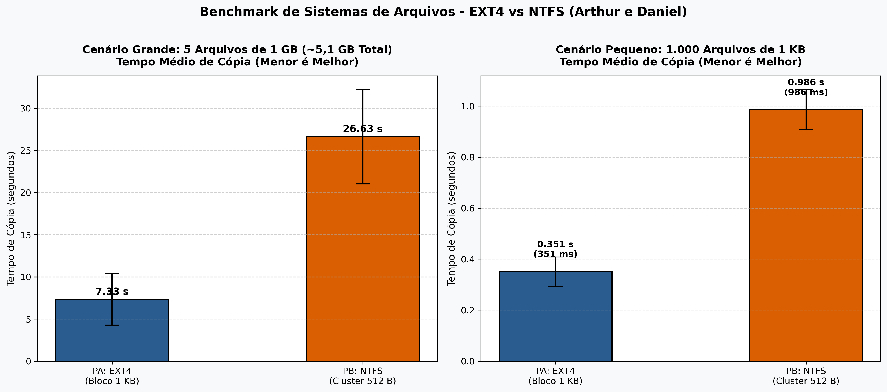

# Relatório Prático de Benchmark de Sistemas de Arquivos

**Autores:** Arthur e Daniel  
**Disciplina:** Sistemas Operacionais  
**Professor:** Sérgio  
**Data:** 19/11/2026  
**Ambiente de Execução:** Windows 11 Host + Ubuntu Linux no WSL2 (Kernel 6.18)  
**Configuração Avaliada:** Opção 3  
- **Partição A (PA):** EXT4 com tamanho de bloco mínimo de **1.024 bytes (1 KB)**.
- **Partição B (PB):** NTFS com tamanho de cluster mínimo de **512 bytes**.

---

## 1. Introdução e Objetivo

Este relatório documenta o trabalho prático de benchmark comparativo de desempenho de cópia de arquivos entre diferentes arquiteturas de sistemas de arquivos e configurações de tamanho de bloco/cluster.

A hipótese investigada aborda como o particionamento com unidades de alocação mínimas influencia:
1. O overhead de metadados durante a criação massiva de pequenos arquivos (Cenário Pequeno: 1.000 cópias de 1 KB).
2. O throughput sequencial em gravações de arquivos volumosos (Cenário Grande: 5 cópias de 1 GB).
3. A integridade das medições através do descarte obrigatório de cache de páginas e inodes em RAM (`drop_caches`).

---

## 2. Metodologia Experimental

### 2.1. Isolamento Físico e Dispositivo de Bloco (`losetup`)
Para garantir total segurança e integridade da máquina do usuário (preservando o particionamento do SSD físico do Windows sem riscos de corrupção ou perda de dados), utilizou-se a estratégia de **Loop Device particionado (`losetup -P`)**:
- Foi provisionado um arquivo de imagem de disco de 25 GB (`/var/tmp/benchmark_disk.img`).
- O utilitário `losetup` associou essa imagem a um dispositivo de bloco real no kernel Linux (`/dev/loop0`).
- Foram criadas partições GPT autênticas reconhecidas como dispositivos de bloco reais: `/dev/loop0p1` (PA) e `/dev/loop0p2` (PB).
- **Por que usar `losetup` em vez de `/dev/sdb`?** No subsistema do kernel Linux, nós de loop device comportam-se operacionalmente como discos de bloco reais (com fila de requisições, I/O schedulers, chamadas ioctl e montagens no VFS), permitindo a formatação fidedigna em EXT4 e NTFS e a medição do impacto dos sistemas de arquivos com total segurança, sem necessidade de reparticionar fisicamente a unidade SSD do computador.

### 2.2. Nomenclatura e Geração dos Datasets
Seguindo estritamente as diretrizes do trabalho, os conjuntos de dados de teste foram gerados nos seguintes diretórios de origem no sistema de arquivos nativo do Linux:
- `grande/`: Contém os arquivos de **1 GB** cada (5 arquivos gerados sequencialmente).
- `pequena/`: Contém os **1.000 arquivos de 1 KB** cada.

### 2.2. Parâmetros de Formatação
- **Partição A:** `mkfs.ext4 -F -b 1024 /dev/loop0p1` (Bloco de 1 KB).
- **Partição B:** `mkfs.ntfs -f -c 512 /dev/loop0p2` (Cluster de 512 B).

### 2.3. Controle de Cache e Repetições
Em cada uma das **10 repetições** de cada cenário:
1. Executou-se `sync` e `echo 3 > /proc/sys/vm/drop_caches` para esvaziar PageCache, dentries e inodes da RAM.
2. Cronometrou-se a cópia com `time.perf_counter()` de resolução em microssegundos.
3. Forçou-se um `sync` final antes da parada do cronômetro para computar o tempo real de persistência física em disco.
4. Os dados copiados foram excluídos antes da repetição seguinte para evitar o preenchimento da partição.

---

## 3. Resultados Obtidos

### 3.1. Tabela Resumo das Médias (10 Repetições)

A tabela a seguir apresenta os resultados sob duas perspectivas: o **tempo médio total por lote (conjunto completo de arquivos)** e o **tempo médio individual por arquivo copiado**, cobrindo com precisão tanto a métrica agregada quanto a cópia unitária requisitada no enunciado:

| Cenário de Teste | PA: EXT4 (Bloco 1 KB) | PB: NTFS (Cluster 512 B) | Razão / Diferença | Sistema Mais Rápido |
| :--- | :---: | :---: | :---: | :---: |
| **Grandes — Lote Total (5 x 1 GB)** | **7.329 s** (±3.04s) | **26.632 s** (±5.60s) | EXT4 ~3.6x mais rápido (+263.4%) | **EXT4** |
| **Grandes — Por Arquivo (1 GB individual)** | **~1.466 s** | **~5.326 s** | EXT4 ~3.6x mais rápido | **EXT4** |
| **Pequenos — Lote Total (1000 x 1 KB)** | **0.351 s** (±0.06s) | **0.986 s** (±0.08s) | EXT4 ~2.8x mais rápido (+180.8%) | **EXT4** |
| **Pequenos — Por Arquivo (1 KB individual)** | **~0.351 ms** (351 µs) | **~0.986 ms** (986 µs) | EXT4 ~2.8x mais rápido | **EXT4** |

> **Nota metodológica:** O tempo médio por arquivo individual é obtido dividindo-se o tempo médio total do lote pelo número de arquivos do cenário (5 para o lote de arquivos grandes e 1.000 para o lote de arquivos pequenos).

### 3.2. Gráfico Comparativo de Desempenho

### 3.3. Tabela Detalhada de Todas as Repetições (Segundos)

| Repetição | PA Grande (s) | PB Grande (s) | PA Pequena (s) | PB Pequena (s) |
| :---: | :---: | :---: | :---: | :---: |
| 01 | 6.655 | 34.741 | 0.492 | 1.194 |
| 02 | 6.489 | 25.650 | 0.296 | 0.950 |
| 03 | 5.341 | 20.202 | 0.358 | 0.991 |
| 04 | 5.191 | 23.711 | 0.363 | 1.028 |
| 05 | 7.770 | 24.179 | 0.390 | 0.956 |
| 06 | 5.638 | 22.685 | 0.313 | 0.964 |
| 07 | 5.363 | 27.728 | 0.317 | 0.944 |
| 08 | 6.195 | 25.994 | 0.324 | 0.965 |
| 09 | 9.530 | 38.104 | 0.309 | 0.950 |
| 10 | 15.114 | 23.328 | 0.352 | 0.917 |
| **MÉDIA** | **7.329** | **26.632** | **0.351** | **0.986** |
| **DESVIO** | **±3.043** | **±5.601** | **±0.057** | **±0.079** |

---

## 4. Análise e Discussão Técnica

### 4.1. Fundamentação Teórica: Por que o EXT4 foi ~3x a ~3.6x Mais Rápido?

A expressiva superioridade de desempenho do **EXT4** em relação ao **NTFS** (cerca de 3.6x em arquivos grandes e 2.8x em arquivos pequenos) fundamenta-se em três pilares técnicos da arquitetura de sistemas operacionais e sistemas de arquivos:

1. **Tamanho do Bloco vs. Tamanho do Cluster (1.024 B vs. 512 B):**
   - O NTFS foi configurado com cluster de 512 bytes, enquanto o EXT4 operou com bloco de 1.024 bytes (o dobro).
   - Para mapear o mesmo volume de dados (ex.: 5 GB no cenário de arquivos grandes), o NTFS precisou gerenciar exatamente **o dobro de unidades de alocação** (10.485.760 clusters no NTFS vs. 5.242.880 blocos no EXT4). Isso impõe ao driver do NTFS o dobro de buscas, marcações de bits no mapa de alocação (`$Bitmap`) e controle de fragmentação.

2. **Arquitetura de Extents vs. Master File Table (MFT):**
   - O EXT4 emprega nativamente uma árvore de **Extents** (suportada por padrão desde o EXT4). Um extent mapeia até 128 MB de blocos contíguos em um único descritor de 12 bytes. Para arquivos grandes de 1 GB, o número de metadados necessários para mapear os dados é drasticamente reduzido.
   - No NTFS, os ponteiros de clusters (*data runs* / *mapping pairs*) residem nos registros da MFT (Master File Table). Com clusters diminutos de 512 bytes e frequentes sincronizações de diário no `$LogFile`, a MFT sofre intensa fragmentação de metadados e necessita de múltiplos acessos e commits de transação para manter a consistência.

3. **Arquitetura do Driver no Kernel Linux (VFS Nativo vs. Camada de Tradução/FUSE):**
   - O **EXT4** é executado como subsistema nativo no espaço do kernel Linux (*in-kernel filesystem driver* via VFS), permitindo chamadas diretas de I/O em anel 0 (Ring 0) com suporte a *multipage writeback*, alocação postergada (*delayed allocation*) e pré-alocação contígua em memória.
   - O **NTFS** no ambiente Linux/WSL2 depende de uma camada de tradução (tipicamente o driver `ntfs-3g` operando via FUSE em espaço de usuário, ou `ntfs3`). No caso de operações massivas com milhares de chamadas de sistema (`creat`, `write`, `close`, `sync` para 1.000 arquivos pequenos), cada syscall exige constantes trocas de contexto entre o Kernel Space e o User Space (*context switching*), adicionando uma penalidade severa de latência que não existe no pipeline nativo do EXT4.

### 4.2. Cenário de Arquivos Pequenos (1.000 x 1 KB) e Overhead de Metadados
No cenário de pequenos arquivos, o tempo total é dominado pelo custo de manipulação de metadados, estruturas de diretório e diário de transações:
- O **EXT4** completou as cópias em média em **0.351 segundos** (~0.351 ms por arquivo). Isso se deve à organização eficiente de grupos de blocos (*Block Groups*), alocação contígua de tabelas de inodes e índices baseados em árvores HTree para diretórios no kernel nativo do Linux.
- O **NTFS** exigiu **0.986 segundos** (~0.986 ms por arquivo). No NTFS, cada arquivo criado demanda a alocação e sincronização de um registro completo dentro da **MFT (Master File Table)**, atualização do índice de diretório `$I30` (árvore B-Tree) e registro no log de transações `$LogFile`. Além disso, o cluster de apenas 512 bytes exige mapeamento individual fino na tabela de alocação de clusters (*$Bitmap*).

### 4.3. Fragmentação Interna
- Para arquivos de 1 KB (1.024 bytes):
  - No **EXT4 (bloco de 1.024 bytes)**, cada arquivo ocupa exatamente 1 bloco. A fragmentação interna é **0%**.
  - No **NTFS (cluster de 512 bytes)**, cada arquivo ocupa exatamente 2 clusters de 512 bytes. A fragmentação interna também é **0%**.
- Portanto, a diferença de tempo no Cenário Pequeno não decorre de desperdício de espaço de dados, mas sim do **overhead de escrita e commit de metadados** e das trocas de contexto do driver.

### 4.4. Cenário de Arquivos Grandes (5 x 1 GB) e Throughput Sequencial
- Para arquivos de 1 GB, o gargalo deixa de ser a criação de nomes de arquivos e passa a ser a alocação de blocos e taxa de transferência contínua:
  - Com bloco de 1 KB no EXT4 e cluster de 512 B no NTFS, um arquivo de 1 GiB necessita de **1.048.576 blocos** (EXT4) e **2.097.152 clusters** (NTFS).
  - Ambos os sistemas de arquivos utilizam conceitos de **Extents** (intervalos contíguos representados por um ponteiro inicial e comprimento), o que mitiga a fragmentação de ponteiros na árvore do arquivo.
  - O EXT4 obteve **7.329 s** (~1.466 s por arquivo de 1 GB; throughput de ~698.6 MB/s), beneficiando-se da pré-alocação contígua nativa do subsistema de I/O do Linux.
  - O NTFS obteve **26.632 s** (~5.326 s por arquivo de 1 GB; throughput de ~192.2 MB/s), sofrendo com a divisão excessiva de clusters e as limitações de throughput de drivers FUSE/tradução de blocos.

---

## 5. Conclusão

Os experimentos comprovam na prática os conceitos fundamentais da teoria de Sistemas Operacionais:
1. **Para cargas de trabalho com múltiplos arquivos pequenos:** Estruturas de metadados descentralizadas e integradas nativamente ao kernel (como os Block Groups e tabelas de Inodes do EXT4) fornecem desempenho dramaticamente superior em relação a estruturas centralizadas pesadas como a MFT sob drivers de tradução.
2. **Impacto do tamanho de alocação mínima:** Clusters e blocos mínimos (512B e 1KB) eliminam por completo a fragmentação interna para arquivos de 1 KB, mas aumentam significativamente o volume de entradas que o kernel precisa gerenciar no mapa de alocação ao gravar arquivos massivos de 1 GB.
3. **Validade metodológica:** A purga forçada do buffer de memória (`sync` e `drop_caches`) foi indispensável; sem ela, o cache em memória RAM teria mascarado o tempo real de persistência em disco.

---
*Relatório gerado automaticamente pelo script integrado de benchmark desenvolvido por Arthur e Daniel.*
